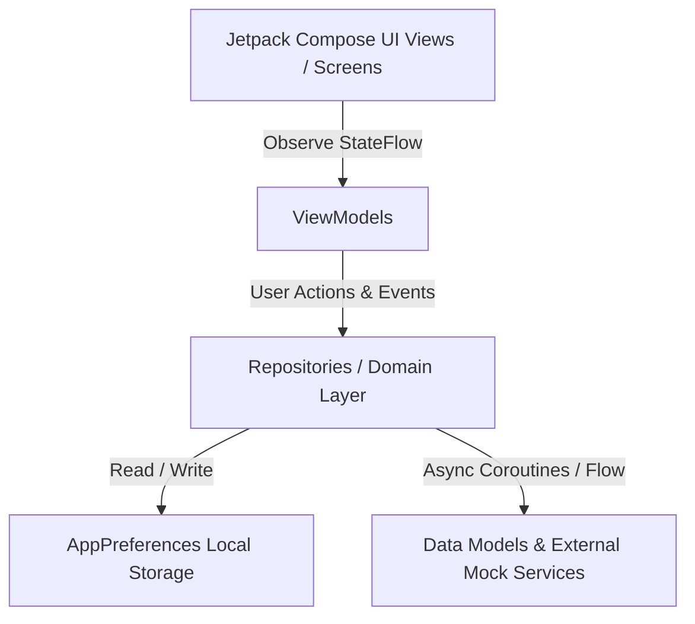

# 🏠 SubletSync — AI-Powered Student Housing & Subleasing Platform

<p align="center">
  
  
  
  
  
</p>

---

## 📌 Executive Summary

**SubletSync** is a native Android mobile application engineered for university students seeking verified campus housing, fair sublet pricing, roommate matching, and AI-driven protection against housing fraud and predatory lease agreements.

Built entirely with **Kotlin**, **Jetpack Compose**, **Material 3**, and **MVVM Architecture**, SubletSync bridges the gap between student housing discovery and legal safety.

---

## 🚀 Key Platform Features

### 🛡️ 1. AI Fake-Listing Shield & Fraud Detection
- **Automated Scam Scanning**: Analyzes listing descriptions and payment requests for fraud patterns (wire transfer requests, cash app only, out-of-country hosts).
- **Price Anomaly Identification**: Flags properties listed significantly below average market rates for the campus quadrant.
- **Risk Score Certification**: Generates a 0–100 Risk Score categorizing listings into `SAFE`, `SUSPICIOUS`, or `HIGH_RISK`.

### 📄 2. Contract Guard AI (Legal Lease Review)
- **PDF Document Picker**: Integrates with Android's system document picker (`application/pdf`) to upload lease agreements.
- **Predatory Clause Identification**: Automatically highlights hidden cleaning fees, non-refundable deposit deductions, 90-day notice traps, and auto-renewal clauses.
- **Legal Recommendations**: Provides plain-English recommendations for students to negotiate safer lease terms.

### 📊 3. Machine Learning Fair-Rent & Utility Estimator
- **ML Fair-Rent Estimator**: Calculates estimated market rent based on square footage, room type (Private Room, Studio, Entire Apartment), facilities, and seasonal campus demand.
- **Utility Bill Breakdown**: Computes estimated monthly electric, AC, water, trash, and high-speed internet costs per roommate.

### 🎓 4. Verified Student Housing & Roommate Matching
- **Institutional `.edu` Authentication**: Restricts host verification to active students with confirmed university email addresses.
- **AI Roommate Compatibility Matching**: Evaluates study rhythm, noise preferences, cleanliness habits, and budget to calculate compatibility match percentages (e.g. `96% MATCH`).
- **Side-by-Side Comparison Matrix**: Allows students to compare multiple sublets across distance to campus, price, amenities, and lease duration.

### 📋 5. Student Safety & Move-In Checklist
- **Interactive Move-In Checklist**: Comprehensive checklist guiding students through pre-move inspection, deposit escrow rules, and landlord permissions.
- **Payment Safety Guidelines**: Educational guide warning against untraceable wire transfers, gift cards, and crypto payments.

---

## 🏛️ System Architecture

SubletSync follows strict **Clean Architecture & MVVM (Model-View-ViewModel)** design principles:



### Tech Stack Components

| Layer | Technology Used |
|---|---|
| **Language** | Kotlin 2.2 |
| **UI Toolkit** | Jetpack Compose + Material 3 |
| **Theme** | Custom Slate Navy (`#0F172A`) & Indigo (`#6366F1`) Palette |
| **Architecture** | MVVM (Model-View-ViewModel) + Clean Architecture |
| **Navigation** | Navigation Compose (`NavHost`, typed routes) |
| **State Management** | `StateFlow` + `collectAsStateWithLifecycle()` |
| **Async & Streams** | Kotlin Coroutines & Flow |
| **Document Selection** | Activity Result Contracts (`GetContent("application/pdf")`) |
| **Local Storage** | `SharedPreferences` via `AppPreferences` |

---

## 📂 Project Directory Structure

```text
com.example.syncmate/
├── MainActivity.kt                  # Root Activity initializing Compose & NavHost
│
├── navigation/
│   ├── AppNavGraph.kt               # Centralized Navigation Graph & Route Handlers
│   └── Screen.kt                    # Typed Navigation Route Definitions
│
├── data/
│   ├── local/
│   │   └── AppPreferences.kt        # User Session & Theme Preference Storage
│   ├── model/
│   │   ├── User.kt                  # Student Profile Data Class
│   │   ├── HousingListing.kt        # Sublet Housing Listing Model
│   │   ├── RoommateProfile.kt       # Roommate Match & Compatibility Model
│   │   ├── RentPrediction.kt        # ML Fair-Rent Input/Output Models
│   │   ├── ContractSummary.kt       # Legal Summary & Flagged Clause Model
│   │   └── FakeListingAnalysis.kt   # Fraud Signal & Risk Assessment Model
│   └── repository/
│       ├── AuthRepository.kt        # Authentication Data Operations
│       ├── HousingRepository.kt     # Sublet Listing Management
│       ├── PredictionRepository.kt  # Machine Learning Fair-Price Engine
│       ├── FakeListingRepository.kt # Scam Shield Analysis Engine
│       └── ContractRepository.kt    # PDF Legal Document Analysis Engine
│
├── ui/
│   ├── theme/
│   │   ├── Color.kt                 # Slate Navy & Indigo Design Palette
│   │   ├── Theme.kt                 # Material 3 SubletSync Dark Theme
│   │   └── Type.kt                  # Typography Scale
│   ├── components/
│   │   ├── AppHeader.kt             # Top Bar Header Component
│   │   ├── AppTextField.kt          # Rounded Dark Outlined Input Field
│   │   ├── PrimaryButton.kt         # Primary & Secondary Buttons
│   │   ├── LoadingIndicator.kt      # Progress Spinner Component
│   │   ├── ErrorMessage.kt          # Reusable Error Banner Card
│   │   └── StatBadge.kt             # Status & Verification Chips
│   └── screens/
│       ├── dashboard/               # Student Main Dashboard Hub
│       ├── loading/                 # App Splash & State Check
│       ├── welcome/                 # SSO Welcome Overview
│       ├── login/                   # Student Login Screen
│       ├── createaccount/           # Account Registration
│       ├── forgotpassword/          # Password Reset Workflow
│       ├── verifyemail/             # .edu Email Verification
│       ├── home/                    # Housing Marketplace
│       ├── search/                  # Search Housing Screen
│       ├── filters/                 # Price & Amenity Filters
│       ├── listingdetails/          # Full Sublet Details & Host Info
│       ├── fairrent/                # ML Fair-Rent Predictor
│       ├── utilitypredictor/        # Monthly Utility Bill Estimator
│       ├── comparelistings/         # Side-by-Side Comparison Matrix
│       ├── fakelisting/             # AI Fake-Listing Shield
│       ├── uploadphotos/            # Post Sublet Form
│       ├── reportlisting/           # Scam & Fraud Reporting
│       ├── contractguard/           # AI Contract Guard Dashboard
│       ├── uploadcontract/          # PDF Lease Upload Picker
│       ├── contractsummary/         # Detailed Legal Clause Review
│       ├── savedlistings/           # Bookmarked Sublets
│       ├── chat/                    # Student Direct Messaging
│       ├── notifications/           # Price Drop & Contract Alerts
│       ├── profile/                 # Student Profile View
│       ├── editprofile/             # Edit Student Information
│       ├── preferences/             # Roommate & Housing Matching Criteria
│       ├── leasechecklist/          # Move-In Inspection Checklist
│       ├── paymentsafety/           # Anti-Scam Payment Rules
│       ├── helpcenter/              # Support & FAQ Center
│       ├── settings/                # App Settings & Dark Theme Toggle
│       ├── privacy/                 # Data Privacy & Document Security
│       └── feedback/                # App Feedback Submission
│
└── viewmodel/
    ├── AuthViewModel.kt             # Handles Authentication & Email Code State
    ├── DashboardViewModel.kt        # Manages Dashboard Recommendations & Matches
    ├── HomeViewModel.kt             # Controls Marketplace State & Search
    ├── HousingViewModel.kt          # Manages Sublets, Filtering & Comparisons
    ├── PredictionViewModel.kt       # Coordinates Fair-Price Calculations
    ├── FakeListingViewModel.kt      # Coordinates Scam Shield Analysis
    ├── ContractViewModel.kt         # Coordinates PDF Lease Analysis State
    └── SettingsViewModel.kt         # Handles Dark Theme & Preferences
```

---

## 📱 Comprehensive Screen Inventory (32 Screens)

| # | Screen | Kotlin File | Description |
|---|---|---|---|
| 1 | **Dashboard** | `DashboardScreen.kt` | Student hub with quick actions, recommendations, roommate matches, and bottom bar navigation |
| 2 | **Loading** | `LoadingScreen.kt` | Splash screen verifying student login tokens and initial state |
| 3 | **Welcome** | `WelcomeScreen.kt` | Onboarding overview introducing student verification and AI features |
| 4 | **Login** | `LoginScreen.kt` | Student `.edu` sign-in screen with `Remember Me` preference |
| 5 | **Create Account** | `CreateAccountScreen.kt` | New student registration form with university selector |
| 6 | **Forgot Password** | `ForgotPasswordScreen.kt` | Password reset request screen |
| 7 | **Verify Email** | `VerifyEmailScreen.kt` | 6-digit verification code entry for institutional `.edu` emails |
| 8 | **Home Marketplace** | `HomeScreen.kt` | Sublet marketplace featuring verified campus housing and AI tool chips |
| 9 | **Search Housing** | `SearchScreen.kt` | Live search screen filtering sublets by university, zone, or price |
| 10 | **Filters** | `FiltersScreen.kt` | Filter modal with price slider and furnished housing options |
| 11 | **Listing Details** | `ListingDetailsScreen.kt` | Detailed sublet breakdown, distance to campus, host details, and inquiry CTA |
| 12 | **Fair Rent Predictor** | `FairRentScreen.kt` | Machine learning fair-rent range calculator |
| 13 | **Utility Estimator** | `UtilityPredictorScreen.kt` | Monthly bill calculator for electricity, AC, water, trash, and wifi |
| 14 | **Compare Listings** | `CompareListingsScreen.kt` | Side-by-side comparison matrix for multiple sublets |
| 15 | **Fake-Listing Shield** | `FakeListingScreen.kt` | AI scam detector analyzing text for wire-transfer fraud and price anomalies |
| 16 | **Upload Sublet** | `UploadPhotosScreen.kt` | Post sublet form to list student housing |
| 17 | **Report Listing** | `ReportListingScreen.kt` | Safety reporting screen to flag fraudulent listings |
| 18 | **Contract Guard** | `ContractGuardScreen.kt` | AI legal lease review dashboard |
| 19 | **Upload Contract** | `UploadContractScreen.kt` | System PDF document picker launcher for lease agreement upload |
| 20 | **Contract Summary** | `ContractSummaryScreen.kt` | Detailed breakdown of flagged predatory clauses, fees, and notice windows |
| 21 | **Saved Listings** | `SavedListingsScreen.kt` | Bookmarked sublets collection |
| 22 | **Direct Chat** | `ChatScreen.kt` | Peer-to-peer student messaging screen |
| 23 | **Notifications** | `NotificationsScreen.kt` | Notifications center for price drops, chat messages, and contract reports |
| 24 | **Profile** | `ProfileScreen.kt` | Student profile overview with verified `.edu` status badge |
| 25 | **Edit Profile** | `EditProfileScreen.kt` | Update student name, university, and bio |
| 26 | **Housing Preferences**| `PreferencesScreen.kt` | Match criteria for roommate rhythm and target budget |
| 27 | **Move-In Checklist** | `LeaseChecklistScreen.kt` | Interactive pre-move inspection checklist |
| 28 | **Payment Safety** | `PaymentSafetyScreen.kt` | Educational guide detailing safe payment practices |
| 29 | **Help Center** | `HelpCenterScreen.kt` | Frequently asked questions and student support |
| 30 | **App Settings** | `SettingsScreen.kt` | App preferences, push notifications, and dark theme toggles |
| 31 | **Privacy Policy** | `PrivacyScreen.kt` | Data privacy commitment and secure contract handling overview |
| 32 | **Feedback** | `FeedbackScreen.kt` | App feedback submission screen |

---

## ⚙️ Getting Started & Building

### Prerequisites
- **Android Studio**: Ladybug (2024.2.1) or newer
- **JDK**: JDK 17
- **Kotlin**: 2.2
- **Min SDK**: API 24 (Android 7.0)
- **Target SDK**: API 37 (Android 15)

### Build & Run
1. **Clone the Repository**:
   ```bash
   git clone https://github.com/252514044sclas-droid/syncmate.git
   cd syncmate
   ```

2. **Open in Android Studio**:
   Open the project folder in Android Studio and let Gradle sync complete.

3. **Build via Command Line**:
   ```bash
   ./gradlew assembleDebug
   ```

4. **Run on Emulator / Device**:
   Select the `app` configuration in Android Studio and click **Run (Shift+F10)**.

---

## 🔌 API & Production Integration Guide

SubletSync is built with interface abstraction layers so backends can be connected seamlessly:

1. **Firebase Authentication**:
   - Replace `DevAuthRepositoryImpl` in `AuthRepository.kt` with `FirebaseAuth.getInstance()`.
   - Add `google-services.json` to `app/`.

2. **Python / Scikit-Learn Housing Model**:
   - Connect your Flask/FastAPI ML server endpoint inside `PredictionRepository.kt`.

3. **LLM Legal Document Analysis Service**:
   - Connect your PDF analysis REST endpoint inside `ContractRepository.kt`.

---

## 📄 License

This project is developed for student housing protection. Distributed under the MIT License.
